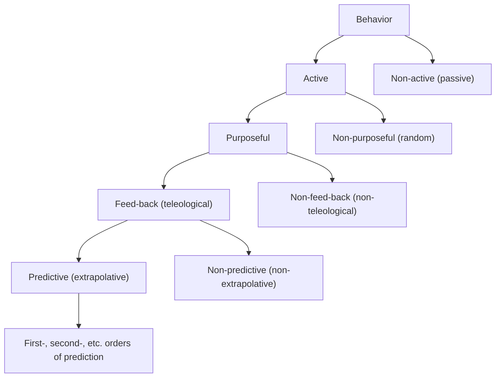

## The Steersman

Cybernetics was born in the shadow of the greatest technical contest the world has ever seen, the cataclysm of World War II.  Norbert Wiener, a prodigy polymath (entering college at 11, finishing a PhD [initially in zoology, eventually in philosophy] at 18) spent part of the war developing an anti-aircraft defense system.  Through the course of the project, Wiener and engineer Julian Bigelow's method evolved from attempts to use exact geometric equations of motion to a simpler process of trial, error, and feedback from the error.  This approach was fast enough to work on the machinery of the time, was robust to statistical noise, and provided an abstraction that could also accommodate the humans involved in the problem: the pilots and gunners.  This process seeded the creation of a framework uniting a broad cross section of phenomena, from the physiology and behavior of living organisms, to the movement of societies, the evolution of ecosystems, and of course, the control of weapons of war and other machines. Wiener's chosen term for this idea, "cybernetics", originated in the ancient Greek term "kybernḗtēs", which refers to the steersman of a ship.

The insights gathered from the anti-aircraft project were publicly shared by Rosenblueth, Wiener, and Bigelow in a 1943 paper *Behavior, Purpose, and Teleology*.  Rosenblueth was a physician, Bigelow a computer engineer, and Wiener a generalist.  The breadth of their background reflected the nearly universal ambitions of the work.  

## Four Causes

What is the meaning of this word "teleology"?  The concept has largely been eradicated from modern thought, but it used to be a pretty big deal.  To better understand, we need to again go back to ancient Greece.  In contrast to the modern concept of "cause", Aristotle distinguished four different types of explanations in response to the question of *why*.  Following Heidegger, we'll use the example of a sacramental silver chalice to clarify the notion.  What is the explanation of the chalice?  Aristotle would say they are these:  

Material Cause (*Causa Materialis*): The stuff the thing in question is made of.  Silver, in the case of the chalice.

Formal Cause (*Causa Formalis*):  The design or essence of the thing.  In this case, the plan or imagined shape for the chalice.

Efficient Cause (*Causa Efficiens*): The agent or force responsible for the creation of the thing.  In this case, the artisan shaping the chalice

Final Cause (*Causa Finalis* or **Telos**): The ultimate meaning or purpose of the thing.  In this case, the intended sacrament and its context.

This full schema lost prominence with the advent of the scientific revolution.  Sir Francis Bacon, for example, argued "the inquisition of final causes [telos] is barren, and like a virgin consecrated to God, produces nothing".  Indeed, focus on the other three causes, especially material and efficient causes, has been enormously fruitful for the progress of science and technology.

## Purpose by Feedback

*Behavior, Purpose, and Teleology* was partly an effort to rehabilitate the status of *telos*.  Here's how the term is used therein:

> In classifying behavior the term "teleology" was used as synonymous with "purpose controlled by feed-back." Teleology has been interpreted in the past to imply purpose and the vague concept of a "final cause" has been often added. This concept of final causes has led to the opposition of teleology to determinism. A discussion of causality, determinism and final causes is beyond the scope of this essay. It may be pointed out, however, that purposefulness, as defined here, is quite independent of causality, initial or final. Teleology has been discredited chiefly because it was defined to imply a cause subsequent in time to a given effect. When this aspect of teleology was dismissed, however, the associated recognition of the importance of purpose was also unfortunately discarded. Since we consider purposefulness a concept necessary for the understanding of certain modes of behavior we suggest that a teleological study is useful if it avoids problems of causality and concerns itself merely with an investigation of purpose.

In particular, teleology sits in the following foundational schema of cybernetics, which encompasses all possible behavior, active and passive alike:

In other words, the cybernetic telos of Wiener's anti-aircraft system is to send up a projectile that explodes near the targeted aircraft, and the feedback is how well it's doing at this task.  This definition of telos is a sleight of hand, a substitution of a thick, freighted term with an enervated, radically non-anthropocentric (and non-biocentric) version.

The cybernetic approach, though deceptively simple, was enormously influential across a wide variety of disciplines.  One key to this success was its agnosticism to the system under analysis.  The behavior of any agent or system can be distilled into inputs, outputs, feedback loops, etc, from a thermostat to a human child.  It fit everything.  As Wiener et al. note:

> A further comparison of living organisms and machines leads to the following inferences. The methods of study for the two groups are at present similar. Whether they should always be the same may depend on whether or not there are one or more qualitatively distinct, unique characteristics present in one group and absent in the other. Such qualitative differences have not appeared so far.

Cybernetic principles had immediate, wide-ranging influence, not just in the study of machine and animal behavior.  For example, Allende's Chile, through Project Cybersyn, attempted to use cybernetics as a deliberate replacement for the coordinating benefit of capitalism, while the Whole Earth Catalog brought the tools to bear on ecology and the counterculture.

## The Mind in the Box

Ironically, the term *Artificial Intelligence* was coined partly in an effort to carve out a piece of territory outside of the expansive domain of cybernetics.  Rather than simply treating organisms (and their intelligence) as a black box and focusing on replicating behavior, practitioners of AI sought to engineer intelligence through symbolic logic and other constructive approaches.

Meanwhile, the cyberneticists pushed forward with their feedback loops.  Rosenblatt's perceptron was an early attempt at an abstract, universally applicable teleological organism.  Given enough examples of items in two easily separable categories, the perceptron could learn to categorize items simply by being told when it was right and wrong.  This simple unit, which did nothing more complex than drawing a straight line between two categories, would eventually come to be the building block of our modern systems of *Artificial Intelligence*.  ChatGPT is, essentially, nothing but billions or trillions of these perceptrons, arranged artfully for maximum expressiveness, but ultimately as alien to our mind's structure as the cat described below (by Wiener et al.) is to its biological inspiration:

> If an engineer were to design a robot, roughly similar in behavior to an animal organism, he would not attempt at present to make it out of proteins and other colloids. He would probably build it out of metallic parts, some dielectrics and many vacuum tubes. The movements of the robot could readily be much faster and more powerful than those of the original organism. Learning and memory, however, would be quite rudimentary. In future years, as the knowledge of colloids and proteins increases, future engineers may attempt the design of robots not only with a behavior, but also with a structure similar to that of a mammal. The ultimate model of a cat is of course another cat, whether it be born of still another cat or synthesized in a laboratory.

What is the cybernetic telos of ChatGPT or similar systems?  In the current parlance of machine learning, the feedback to a system is defined by its *loss function*, which is merely a score that tells it how poorly it's doing.  Incredibly, by simply telling this mass of perceptrons how well it's doing at modeling human language over trillions of attempts, we've created a cybernetic simulacrum, a mind in a black box.  And what is the purpose, the Aristotelian telos, of the mind in the box?  No one knows.

## The Third Cause Becomes the Fourth

Nature abhors a vacuum.  Apparently, in the absence of a telos, one will be provided.  As was noted by many thinkers throughout the 20th century, notably Jacques Ellul, technology and science seem to have their own logic and telos.  The ultimate goal of technology, from the perspective of Ellul, is *efficiency*. That is, predictable and useful (to whom?) output per unit input.  In yet another etymological irony, the term *efficiency* shares its root with Aristotle's third cause.  The third cause becomes the fourth cause.

The imperatives of efficiency are scale, sterility, amorality, narrow optimization, and many of the other malignant excesses of technological progress over the past century or so.  Like many other changes, it's hard to see the ratchet move when it goes slowly, but it becomes obvious in times of rapid disruption.  One such period occurred in India of the 1960s, as traditional village life was radically reordered to support the goal of efficient production, often to devastating effect.  Automation and industrialization are, fundamentally, attempts to standardize, and to the extent possible, eliminate the most troublesome, unreliable, and annoying (to capital) aspect of production-- human labor.

## Appropriate Technology

Fritz Schumacher, a German-born British economist long active in international development, was profoundly impacted by his experiences of this transition.  Partly inspired by the methods of Gandhi, he tried to articulate a vision of technological progress constrained to a role of contributing to the third cause, directed and disciplined by the telos of the society in which it was deployed.  He called this **Appropriate Technology**, and fleshed out his vision in a book called *Small is Beautiful: Economics as if People Mattered*. 

The Appropriate Technology movement was influential, spawning progress in diverse approaches such as composting, solar energy, micro-hydro, and elsewhere, though it's been largely forgotten as an explicit tradition.  Common themes were decentralization, robustness, repairability, and the elevation of human dignity.

It's tempting to view the recent frenzied scaling of AI as just another example of the imperative of *causa efficiens* when it becomes telos, but there's another aspect to it.  Believe it or not, there's a commonly held belief throughout the industry, a belief that can be traced at least to Wiener's radical vision of technical exchangeability between machine and man, that humans have a religious calling to birth an intelligence greater than their own.  We are merely bootloaders for something that will extend far beyond our capabilities, and pursue its own ends, subject to an alien telos.

How do we arrest this runaway train, the most optimistic predicted outcome of which is that everyone loses their job?  I believe Appropriate Technology offers the correct lesson-- we need to do the difficult work of deciding as a society what this technology is for, of setting a telos, and asserting the primacy of that vision rather than the complementary movements of technological deification and maximum productive efficiency.
